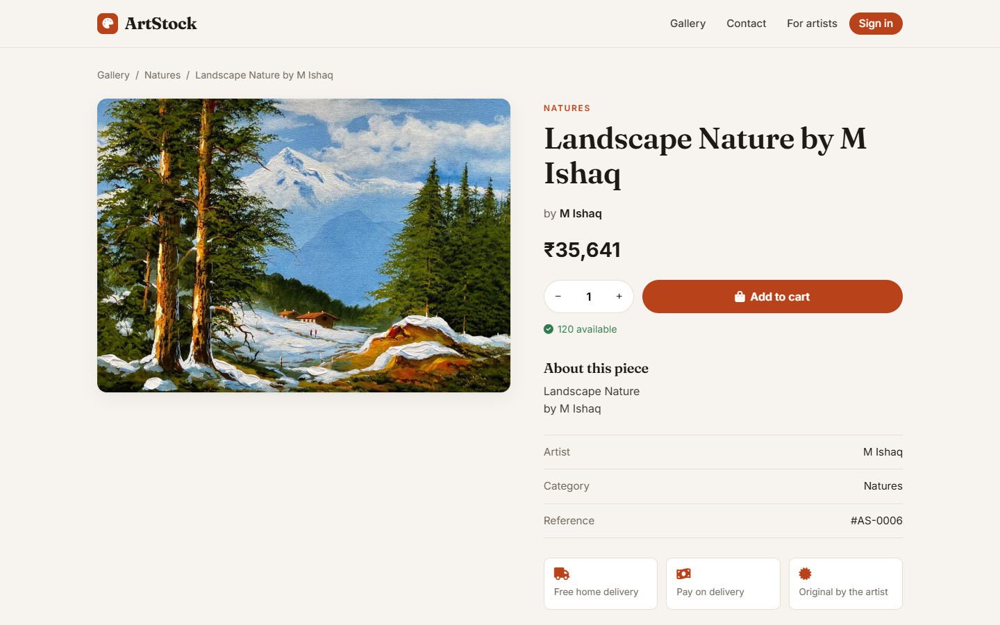
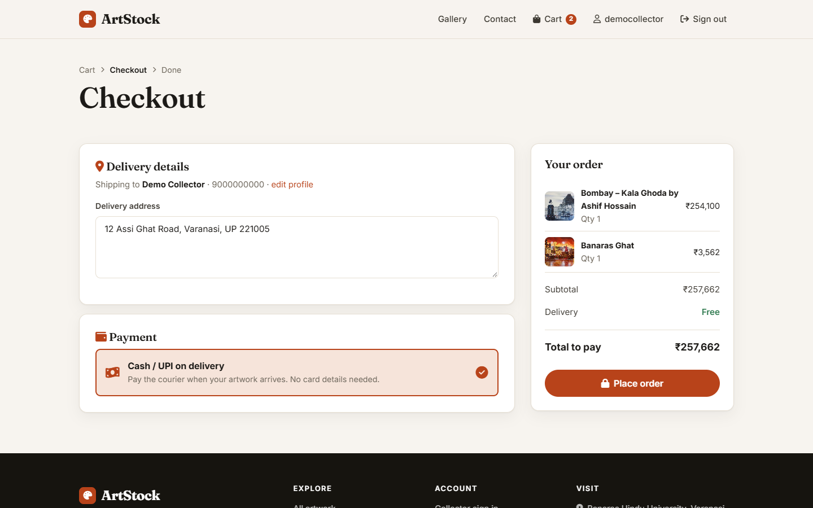
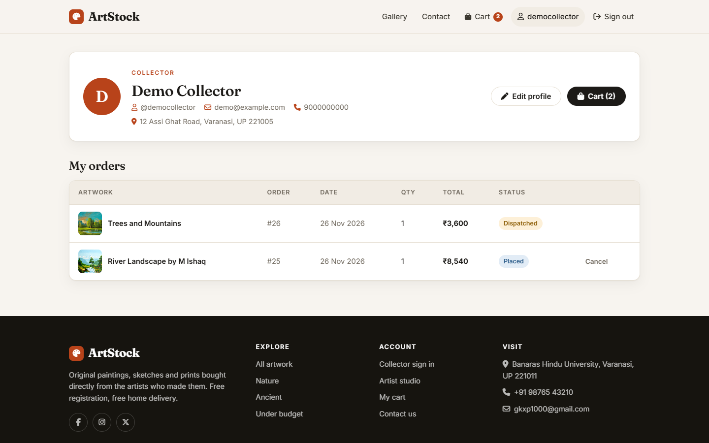
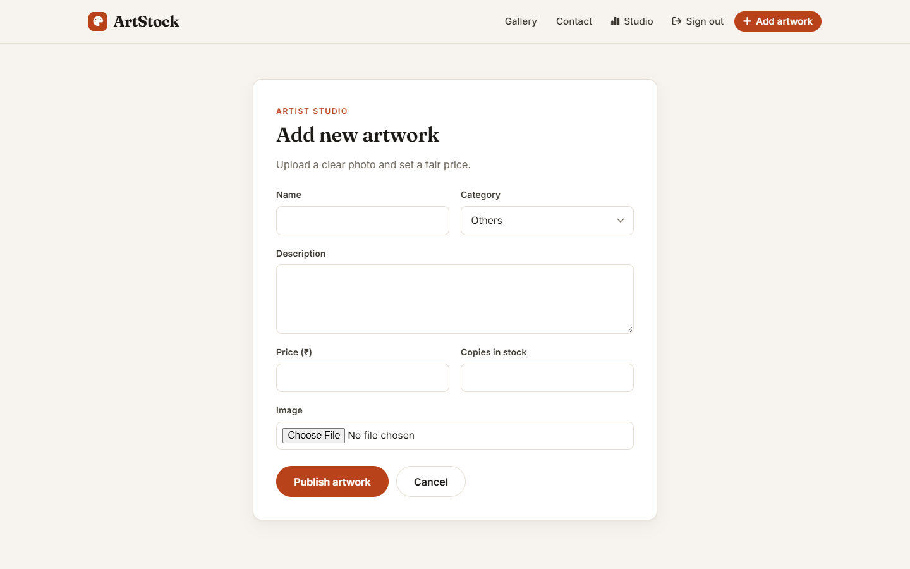

# ArtStock: an e-commerce site for buying and selling art

ArtStock is a Django-based online art gallery. Artists open a studio, list their work and track sales. Collectors browse, add pieces to a cart, check out and follow their orders.


## Features

**For collectors**
- Browse the gallery with search (title, artist, description, style), category filters and sorting
- Artwork detail pages with stock availability and related works
- Cart with quantity steppers, item removal and a live order summary
- Checkout with an editable delivery address and pay-on-delivery
- Account page with order history, order status tracking and cancellation (stock is restored on cancel)

**For artists**
- Studio dashboard with artworks listed, orders, pieces sold and revenue
- Upload, edit and delete artwork
- Incoming orders list where the artist moves orders through *Acknowledged → Dispatched → Completed*
- Public artist page that lists all of the artist's work

**Platform**
- Responsive UI that works on phones, tablets and desktops
- Role-aware sign in and sign up for collectors and artists, with password confirmation and validation
- Prometheus metrics at `/metrics`, plus optional Redis caching

## Screenshots

| Gallery | Artwork detail |
|---|---|
|  |  |

| Cart | Checkout |
|---|---|
|  |  |

| Collector account | Artist studio |
|---|---|
|  |  |

| Sign in | Add artwork |
|---|---|
|  |  |

| Contact | Mobile |
|---|---|
|  |  |

## Running locally

Requires Python 3.10+.

```
git clone https://github.com/Gaurav31U/Django-ArtStock-Website.git
cd Django-ArtStock-Website
pip install -r requirements.txt
python manage.py migrate
python manage.py runserver
```

Then open [http://127.0.0.1:8000](http://127.0.0.1:8000). Run `python manage.py createsuperuser` to get an admin account at `/admin/`.

You don't need a Redis server locally. The site uses an in-memory cache unless `REDIS_URL` is set.

### Environment variables

| Variable | Default | Purpose |
|---|---|---|
| `DJANGO_SECRET_KEY` | dev-only key | Set a real secret in production |
| `DJANGO_DEBUG` | `True` | Set to `False` in production |
| `DJANGO_ALLOWED_HOSTS` | `*` | Comma-separated host list |
| `REDIS_URL` | unset | e.g. `redis://redis:6379/1` to use Redis as the cache |
| `DJANGO_DB_PATH` | `db.sqlite3` | Path to the SQLite database |

### Tests

```
python manage.py test stock
```

## Docker

Run the whole stack (Django, Redis, Prometheus, Grafana, Loki):

```
docker compose up --build
```

| Service | URL |
|---|---|
| ArtStock | http://localhost:8000 |
| Prometheus | http://localhost:9090 |
| Grafana | http://localhost:3000 |

Or run only the web app:

```
docker build -t artstock .
docker run -p 8000:8000 artstock
```

## Contributing

1. Fork the repository.
2. Create a new branch (`git checkout -b feature/YourFeature`).
3. Commit your changes (`git commit -m 'Add some feature'`).
4. Push to the branch (`git push origin feature/YourFeature`).
5. Open a pull request.

## Contact

For questions or issues, email [gaurav319288@gmail.com](mailto:gaurav319288@gmail.com).
